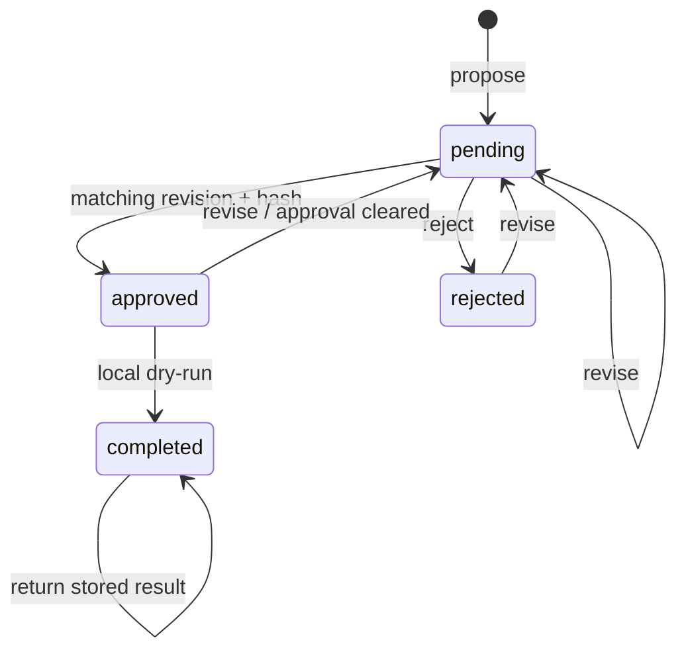

# Draft Approval Review Queue

A local Python and SQLite prototype for reviewing structured action drafts before
running a **local dry-run**. It does not submit applications, post issues, send
messages, make HTTP requests, or call an LLM. An agent can produce the input JSON;
this project owns the review lifecycle, not model inference.

Created in October 2026 with AI coding assistance as a portfolio project. It is
separate from the author's earlier coursework and internship experience.

## Why this project

A boolean `confirm=true` flag does not prove that someone reviewed the current
version of a draft. This prototype binds a review decision to the exact revision
and SHA-256 fingerprint, invalidates approval after edits, and records transitions.
It makes the workflow inspectable without connecting to a live service.



## Run

Python 3.11 or newer; no third-party packages, account, API key, or network needed.

```sh
python demo.py
python -m unittest discover -s tests -v
```

The demo uses synthetic content and a temporary database. It demonstrates a
blocked unapproved action, approval invalidation, re-approval, and an idempotent
dry-run. The temporary database is discarded when it exits.

## CLI walkthrough

```sh
python review_queue.py propose examples/issue.json
python review_queue.py show ACTION_ID
python review_queue.py approve ACTION_ID --revision 1 --sha256 HASH_FROM_SHOW
python review_queue.py dry-run ACTION_ID
python review_queue.py events ACTION_ID
```

Replace the uppercase placeholders with the `id` and `sha256` returned by `show`.
Read the payload before approving. `reject` accepts the same revision/hash fields.
To revise, edit a JSON file and run:

```sh
python review_queue.py revise ACTION_ID examples/issue.json --revision CURRENT_REVISION
```

The revised draft returns to `pending`. Previous approval cannot authorize it.
Use `--db PATH` before the subcommand to choose a database. The default local
database is excluded by `.gitignore`.

## Implementation

- Canonical JSON fingerprints bind approval to kind, destination, title, and body.
- SQLite `BEGIN IMMEDIATE` serializes review/edit/dry-run transitions.
- Expected revisions prevent an old editor overwriting a newer draft.
- Completed dry-runs return their stored result instead of repeating the adapter.
- Parameterized SQL treats SQL-looking strings as ordinary data.
- HTTPS destination validation rejects embedded URL credentials. URLs are labels;
  the program never fetches them.
- An event table records transitions, revisions, and UTC timestamps.

## What the tests cover

Pending/rejected actions, stale revisions, wrong hashes, approval invalidation,
completed-state edits, SQL-like titles, payload tampering, input shape, persistence,
and concurrent dry-runs. The demo and tests are offline. See `VALIDATION.md` for
the checks actually run during packaging.

## Limits

This is **workflow integrity, not an authentication or sandbox boundary**. Anyone
who can run the CLI can approve; a host must restrict the approval command to a
real human. Direct database access can alter both payload and fingerprint, and
the audit table is not tamper-proof. Hash checks catch mismatched stored payloads,
not a hostile database administrator. Raw prompts/content are not made safe by a
fingerprint.

The adapter only stores a local result in the same database transaction. Its
idempotency guarantee does not extend to HTTP services. Real execution would need
authentication, recipient-specific authorization, an outbox/recovery strategy,
remote idempotency support, secret management, and deployment-specific review.
No production or live-service validation is claimed.

## Attribution

Built with OpenAI Codex assistance. Uses Python standard-library `sqlite3`,
`hashlib`, `json`, `argparse`, and `unittest`; no third-party code is bundled.
The owner has not selected an open-source license. Public visibility alone does
not grant an open-source license.
